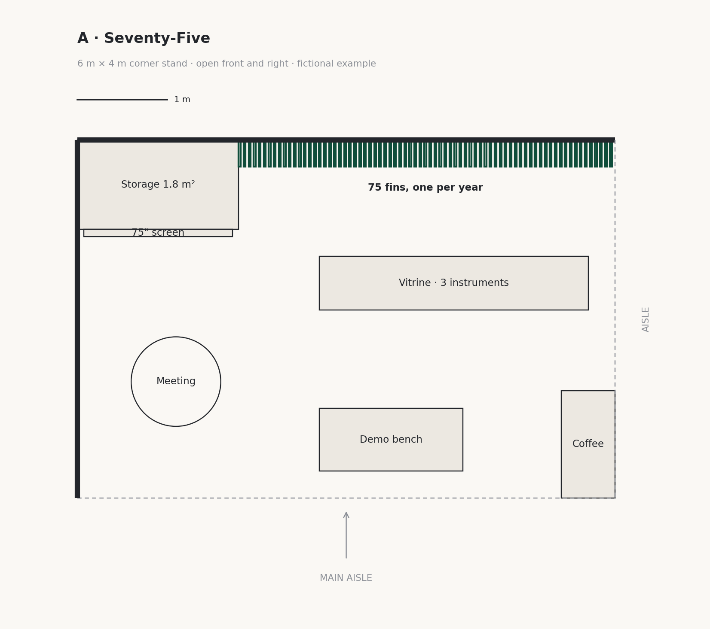
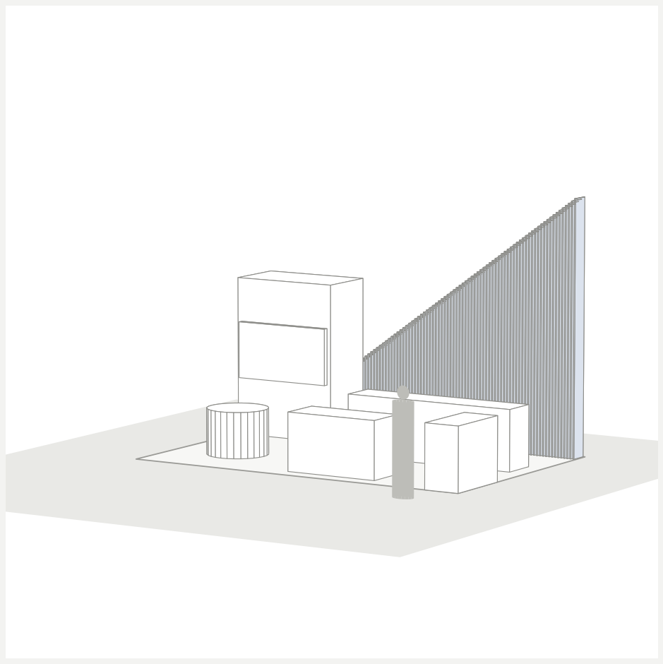

# booth-proposal

**A design-first AI studio partner for exhibition and trade-show booths.**

Give it a booth RFP (and, if you like, reference photos). It returns three art-directed concepts from different design territories, each with an idea, a visitor experience, what the booth says, an architectural plan, a white massing model and two concept renders locked to the real dimensions. Requirements, assumptions and RFP compliance are handled quietly in an appendix.

It is an [Agent Skill](https://agentskills.io): one folder that works in Claude Code, Claude.ai, Codex, ChatGPT and GitHub Copilot.

[中文说明](README.zh-CN.md)

| Plan drawing | Massing model (render reference) |
| --- | --- |
|  |  |

*From the fictional worked example: 75 fins, one per year, rising from 1.2 m to 4.2 m on a 6 × 4 m corner stand.*

## How it works

**Constraints first in thinking, design first in showing.**

| Step | What happens | Gate |
| --- | --- | --- |
| 1 Brief | Reads the RFP and every client file; requirements with sources, assumptions instead of questions, content inventory | Every hard requirement has an ID and a source |
| 2 Frame | Sorts constraints into four tiers, sizes the program, runs area and depth budgets | Frame card complete |
| 3 Ideas | Insight, message platform, references; five or six ideas across design territories; three chosen | No-swap test, rough fit |
| 4 Develop | Geometry spec → check → plan and massing → content map → concept text → creative director critique | Geometry check passes |
| 5 Visualise | Hero view and front view, generated on the massing images | Consistency and design checks |
| 6 Pitch pack | Design first, appendix last | Every requirement accounted for |

It never stops to ask for missing information: it makes a reasoned assumption, labels it, and keeps going. Change anything afterwards (`change A1: three sides open`) and only the affected parts are redone.

## Install

The skill lives in [`skills/booth-proposal/`](skills/booth-proposal). Its scripts need Python 3 with matplotlib and numpy:

```bash
pip install -r requirements.txt
```

A CJK font (such as Noto Sans CJK) is only needed for Chinese or Japanese labels on plans.

### Claude Code (terminal, VS Code, JetBrains)

As a plugin:

```
/plugin marketplace add ocrevo/booth-proposal
/plugin install booth-proposal@ocrevo
```

Or copy the folder yourself: `skills/booth-proposal` → `~/.claude/skills/booth-proposal` (all projects) or `<project>/.claude/skills/booth-proposal` (one project).

### Claude.ai and Claude Desktop

Download [`dist/booth-proposal.skill`](dist/booth-proposal.skill) and upload it in the Skills section of Settings. Code execution must be enabled. Claude does not generate images itself: connect an image-generation tool, or take the prompt pack and massing images to an image model.

### Codex and ChatGPT

Copy `skills/booth-proposal` to `<project>/.agents/skills/booth-proposal` or `~/.agents/skills/booth-proposal`. The Codex CLI, IDE extension and the ChatGPT desktop app pick it up; ChatGPT generates the renders natively.

### GitHub Copilot in VS Code

Copy the folder to `<project>/.github/skills/booth-proposal` or `<project>/.agents/skills/booth-proposal`.

## Use

Put the RFP (and any reference photos) in the conversation or workspace and type `start`.

| Command | What it does |
| --- | --- |
| `start` | Run all six steps |
| `step mode` | Pause after each step for review |
| `change <what>` | Change an assumption, a size, a material or a word; only what depends on it is redone |
| `add style` | Add reference images |
| `show <item>` | Show any card: `show brief`, `show frame`, `show content`, `show geometry B` |
| `render A` | Re-render concept A |
| `pack` | Rebuild the pitch pack |
| `status` | Progress, versions, assumptions |

In an IDE or agent with a workspace, the skill keeps the project on disk:

```
<project>/
  input/        RFP, venue manual, client materials, reference images
  brief/        requirement card, venue card, frame, content, style cards
  concepts/A/   concept.md, geometry.json, plan.png, massing-hero.png, massing-front.png, prompts.md, renders/
  pack/         the pitch pack
```

Edit `concepts/B/geometry.json` by hand and ask for a re-check, or run the scripts yourself.

## The geometry scripts

Every concept has a geometry spec (JSON) that is the single source of truth for its dimensions.

```bash
S=skills/booth-proposal/scripts
E=skills/booth-proposal/assets/examples/halvard-geometry-A.json

python $S/booth_geometry.py check   $E          # PASS or FAIL with reasons
python $S/draw_plan.py              $E plan     # plan.png and plan.svg
python $S/booth_geometry.py massing $E massing  # massing-hero.png and massing-front.png
```

The check enforces the footprint, height limit and height zones (for line-of-sight rules), overlaps, walkways (0.9 m / 3 ft) and headroom (2.1 m / 7 ft), required program items, supports for overhead elements, a no-rigging rule, and rows of repeated elements. The spec format is documented at the top of `booth_geometry.py`.

## Renders

Image models do not follow dimensions written in words, so renders are generated on the massing images: View 1 (eye-level three-quarter) on `massing-hero.png`, View 2 (front) on `massing-front.png` plus View 1. Every prompt opens with a fixed-geometry block. This greatly improves dimensional fidelity but cannot guarantee it: dimensions are governed by the geometry spec, and renders are labelled as concept visualisations.

## Example and tests

- Worked example (fictional client): [`skills/booth-proposal/assets/examples/halvard-example.md`](skills/booth-proposal/assets/examples/halvard-example.md)
- Test cases: [`skills/booth-proposal/evals/`](skills/booth-proposal/evals). Run them in a fresh session after every change.

## Limits

- Concept stage only: not construction drawings, structural design or engineering sign-off. Program sizes, walkway and headroom values are rules of thumb; venue rules and your designer decide.
- No pricing.
- Never invents facts: every line on the walls traces to the client's own material, and bold claims go on a sign-off list.

## Contributing

Issues and pull requests are welcome. Please describe the booth scenario that went wrong, add or update a test case in `evals/`, and keep any client material out of the repository: use fictional examples only.

## License

[MIT](LICENSE)
